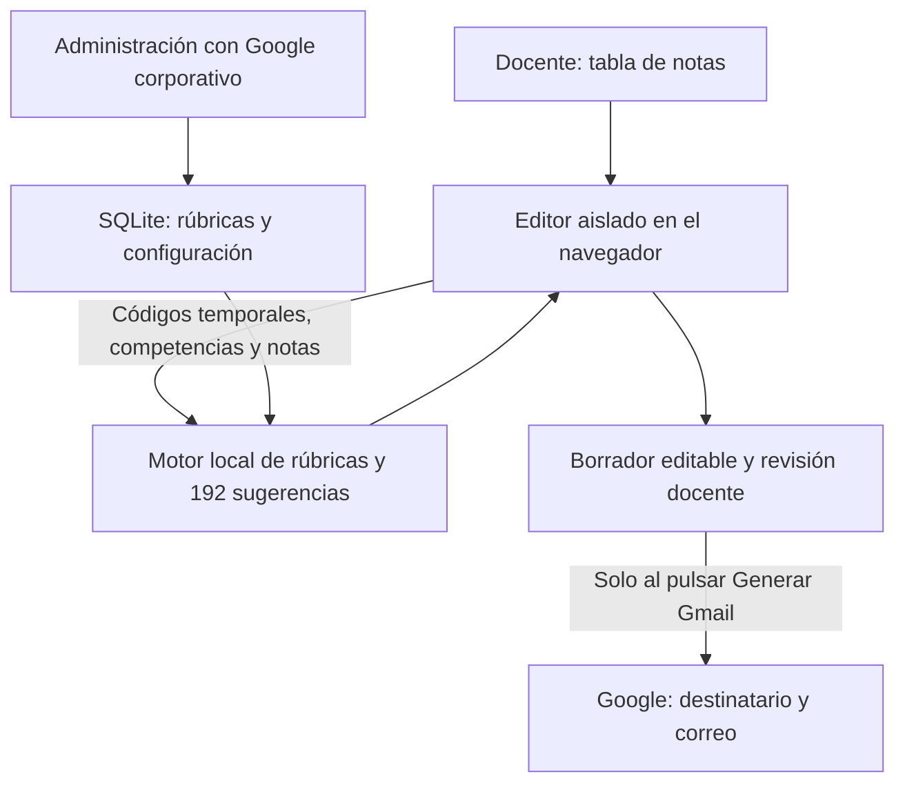

# CC-feedback sin inteligencia artificial

Rama `no-ia`, creada desde `puter-llm` con el banco local de 192 sugerencias. No integra SDK, autenticación, llamadas ni modelos de IA. Las otras ramas conservan sus variantes anteriores.

## Funcionamiento

1. Pega seis notas por alumno, con nombre y correo opcionales.
2. Genera los borradores localmente: el código selecciona las valoraciones de rúbrica y las sugerencias por nivel.
3. Abre cada borrador, revisa o edita su contenido y confirma la revisión.
4. «Generar Gmail» abre el correo para su revisión final; no lo envía automáticamente.
5. Borra los datos al terminar. También se retiran al salir o tras quince minutos sin actividad; suspender el equipo puede retrasarlo.

Se mantienen el editor aislado, las cabeceras opcionales, los borradores colapsados, Google corporativo para Administración y la configuración pedagógica en SQLite. Las ediciones invalidan la revisión anterior.

## Privacidad y RGPD

Las notas y borradores se procesan en memoria del navegador, sin enviarse al servidor ni a proveedores de IA. La página principal bloquea conexiones de red mediante `connect-src 'none'` y solo admite scripts del propio origen. El editor conserva su sandbox y su política restrictiva. La base de datos almacena configuración pedagógica, no resultados del alumnado.

El servidor puede registrar datos de conexión. Google interviene en el acceso administrativo y, por acción expresa, al abrir Gmail: el destinatario y el texto pasan a Google en la URL. El borrado local no alcanza Gmail, historial, portapapeles ni copias externas, ni elimina sesiones o cachés dejadas por variantes anteriores. El procesamiento local no equivale a anonimización ni acredita por sí solo cumplimiento del RGPD. El centro debe completar la información de privacidad y validar finalidad, base jurídica, conservación, proveedores y autorización institucional antes del uso real.

## Despliegue en PythonAnywhere

Publica la rama completa y recarga la aplicación. `.env` se carga junto a `server.py`, con prioridad de las variables del proceso. Conserva `GOOGLE_CLIENT_ID`, `GOOGLE_CLIENT_SECRET`, `SECRET_KEY` estable y `ADMIN_USER`. `DATABASE_PATH` relativo se resuelve desde el directorio de la aplicación. No se necesitan credenciales ni modelos de IA.

No publiques la raíz del repositorio mediante mapeos estáticos: podrían exponer archivos privados o evitar las cabeceras de Flask. Verifica estilos, generación y acceso administrativo después de desplegar. La protección CSRF y el refuerzo de sesiones administrativas siguen pendientes de revisión.

## Pruebas

- `node --test tests/core.test.cjs tests/advice-bank.test.cjs`
- `python tests/test_server.py`
- `node tests/local.browser.cjs` (Playwright y navegador; `BROWSER_EXECUTABLE` permite elegir ejecutable).

### Banco local de sugerencias

`advice-bank.js` incorpora 192 propuestas editoriales: seis familias de competencias, cuatro niveles y ocho acciones distintas por grupo y nivel. Usa los mismos umbrales del motor de rúbricas: menos de 5; de 5 a menos de 7; de 7 a menos de 8,5; y de 8,5 a 10. Las subcompetencias utilizan su familia correspondiente.

La selección se hace en el navegador, sin llamadas a IA ni almacenamiento de notas. Cada grupo y nivel agota sus ocho propuestas antes de repetir; tampoco repite la última al empezar una nueva ronda. La secuencia se reinicia al recargar y no representa una evaluación adicional del alumno. Grupos de más de ocho alumnos con la misma competencia y nivel pueden recibir propuestas repetidas. El docente debe revisar la pertinencia de la actividad, especialmente cuando la nota agregada no refleja todas las subcompetencias.

Se conservan las rúbricas y los textos configurados en Administración. Los seis consejos de instalación originales, reconocidos por su patrón y texto exactos, dejan paso al banco; un consejo nuevo o modificado coincidente tiene prioridad (el primero en el orden configurado), para todos los niveles. El banco se muestra y edita en Administración → Consejos, por competencia y nivel. Se almacena en la tabla `advice_bank` de SQLite. La inicialización incorpora las 192 entradas de `advice-bank.seed.json` sin sobrescribir ediciones existentes. `advice-bank.js` conserva un catálogo de respaldo. Tras guardar, recarga la aplicación para generar nuevos borradores con los cambios; los borradores abiertos no se modifican. Incluye el archivo de semillas al desplegar y conserva una copia de la base de datos.
